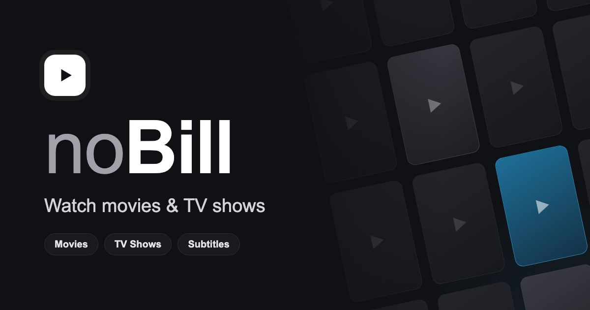
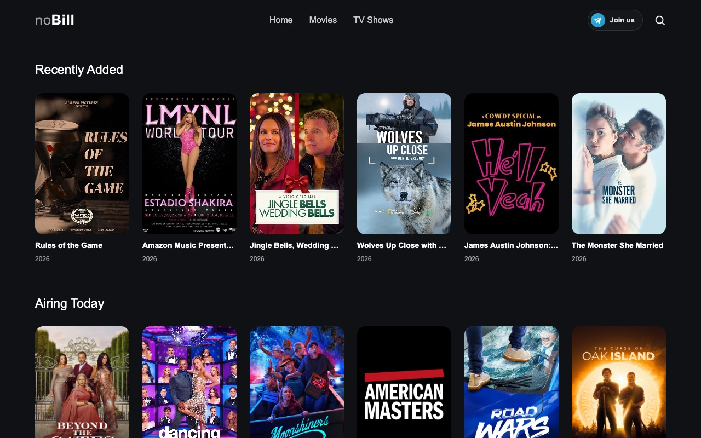

# noBill

**Watch Movies and TV shows — no bill, no sign-up.**

noBill puts thousands of movies and TV shows in one place. Search any title, check ratings and plots,
browse every season and episode, and press play. It works on phone, tablet and computer, with subtitles,
fresh picks every day and a *Recently Added* row so you never miss what's new.

## Join us on Telegram

New releases and updates are posted on our channel:

👉 **[Join the noBill Telegram channel](https://t.me/+RIs5-eBueX1kZTUy)**

## Under the hood

- **Front end:** React 19, React Router, Vite and Tailwind CSS v4, fully responsive.
- **Back end:** a small Node.js server with no runtime dependencies. It combines video catalog of ~118k titles behind its own `/api`, so the API key never reaches the browser.
- **Speed and cost:** three cache layers (memory, disk, Cloudflare CDN), plus daily and per-minute API budgets, so API usage grows with the number of titles viewed, not with traffic.
- **Security:** strict Content Security Policy and security headers, per-visitor rate limits, input validation, path-traversal protection, and cross-site API calls refused.
- **Deployment:** a one-command installer for an Ubuntu server: Caddy (HTTPS), a sandboxed systemd service, a firewall that only admits Cloudflare, fail2ban, SSH key-only login and automatic security updates.

## Disclaimer

noBill is a fan project, made by fans for fans, **for educational purposes only**. It does not host or store
any video files; all media is embedded from third-party providers, and titles and posters belong to their
respective owners. Rights holders can have a title removed through the site's *Rights holders* page.
